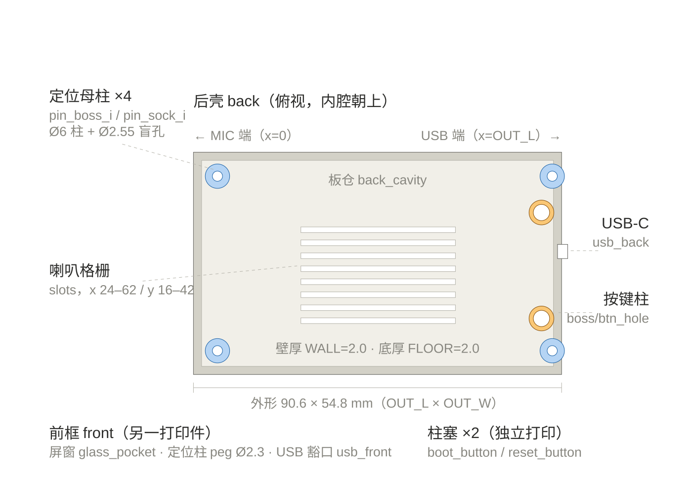

# 外壳部位词典（make_case.py 对照表）

外壳全部由 `make_case.py` 参数化生成，每个部位在脚本里都有名字和变量。
**向编码工具提改动时，直接用下面的中文名或脚本名即可**，例如：
"把喇叭格栅的槽加宽一点"、"boot 按键柱再加高 1mm"、"屏窗四周留边再窄 0.5mm"。

## 标注图

**「3d 外壳标注图」= `3d-model/PARTS-diagram.svg`**。以后听到这个说法，直接打开这张图。
图是后壳俯视（内腔朝上），与 `preview.png` 视角对应；前框和柱塞在底部图例里。

## 坐标系约定（脚本内）

- **x 轴**：沿板长方向。`x=0` 是 **MIC 端**（屏幕/玻璃这一头），`x=OUT_L` 是 **USB 端**。
- **y 轴**：沿板宽方向（两条长边）。
- **z 轴**：前壳 `z=0` 是外面板（打印时朝下、与玻璃齐平）；后壳 `z=0` 是外背面（打印时平放床面）。
- 外形：**90.6 × 54.8 mm**（`OUT_L × OUT_W`）。

## 前壳 front（→ made_case_front.stl）

| 中文名 | 脚本对象 / 变量 | 位置与关键尺寸 |
| --- | --- | --- |
| 前框 | `front`，`FRONT_H=6.2` | 整体框体，高 6.2mm |
| 屏窗（玻璃座/开孔） | `glass_pocket`，`GLASS_X0/X1/Y0/Y1` | 靠 MIC 端，对应 69.2×50 玻璃，四周留边 |
| 定位柱 ×4 | `peg_0..3`，`PEG_POST_R=1.15`（Ø2.3） | 四角，插进后壳母柱的 Ø2.55 盲孔 |
| USB 豁口 | `usb_front` | USB 端短边，只去掉 0.2mm 让位唇边 |

## 后壳 back（→ made_case_back.stl）

| 中文名 | 脚本对象 / 变量 | 位置与关键尺寸 |
| --- | --- | --- |
| 板仓（PCB 内腔） | `back_cavity` | 中间大腔，`IN_L×IN_W = 86.6×51.6` |
| USB-C 开槽 | `usb_back` | USB 端短边居中，9.4 × 3.5mm |
| 定位母柱 ×4 | `pin_boss_i` / `pin_sock_i` | 四角，Ø6 柱 + 顶部 Ø2.55 盲孔（`SOCK_R`） |
| 按键导向柱 ×2 | `boss_{cy}` / `btn_hole` / `btn_seat` | 靠 USB 端（距端 1mm、距长边 10.8mm），boot 和 reset 各一 |
| 喇叭格栅 | `slot_*` 循环，`gx0/gx1/gy0/gy1` | 板仓中部偏 MIC 端，x 24–62、y 16–42，8 条横槽（宽 1.4、间距 3.2） |
| 后壳高度 | `BACK_H=17.0` | 2mm 底 + 板后 15mm（喇叭、电池空间） |
| 壁厚 / 底厚 | `WALL=2.0` / `FLOOR=2.0` | 四壁与底部 |

## 柱塞 ×2（→ made_case_buttons.stl，独立打印件）

| 中文名 | 脚本对象 / 变量 | 说明 |
| --- | --- | --- |
| boot 柱塞 | `boot_button` | 法兰 `flange_r=2.5` + 杆 `stem_r=1.75`（Ø3.5），杆穿导向孔 Ø4.0 |
| reset 柱塞 | `reset_button` | 同上，两个几何相同 |

## 常用关联变量速查

- `GAP=0.6`（板与内腔单边间隙）、`TOL=0.2`（各配合单边余量）
- `SOCK_R=1.275`（母柱盲孔，原 0.1 间隙太紧改为此值）
- `boss_top`、`seat_z`（按键柱高度链，改一个柱高要连带柱塞）
- `GLASS_FROM_MIC=8.8`（玻璃上沿离 MIC 端距离）

## 改动流程

1. 说部位名 + 想法 → 改 `make_case.py` 里对应变量。
2. 在 Blender 里重跑脚本（如 `blender -b -P 3d-model/make_case.py`），自动导出三个 STL 并重渲 `preview.png`、保存 `made_case.blend`。
3. 打印前核对脚本末尾打印的 ray 检查输出（各孔是否打穿）。
